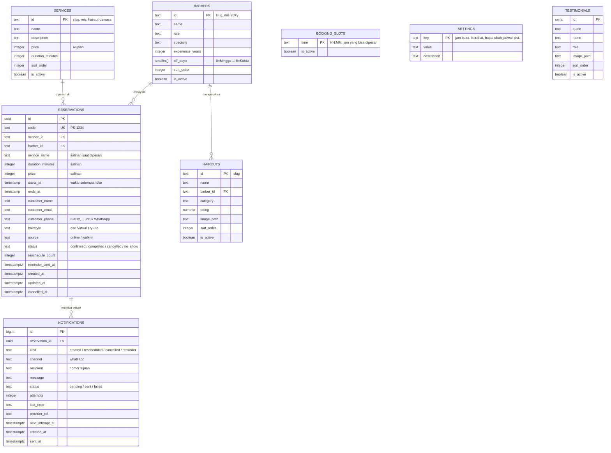

# ERD Web External (Customer)

Database PostgreSQL yang dipakai web customer, diambil dari `backend/migrations/001` sampai `003`.
Diagram di bawah tampil otomatis di GitHub. Versi gambar: [erd-web-external.png](erd-web-external.png).

## Penjelasan singkat

| Tabel | Fungsi |
|---|---|
| `services` | Menu layanan, harga, dan durasi. |
| `barbers` | Kapster beserta hari libur mingguan (`off_days`). |
| `haircuts` | Galeri gaya rambut; tiap gaya dikerjakan satu kapster. |
| `reservations` | Inti sistem: satu baris per reservasi. Nama, durasi, dan harga layanan **disalin** ke sini supaya riwayat tidak berubah kalau menu diubah. |
| `notifications` | Antrean pesan WhatsApp (invoice, ubah, batal, pengingat). Pesan ditulis bersamaan dengan perubahan reservasi, lalu dikirim oleh worker. |
| `booking_slots` | Daftar jam mulai yang bisa dipesan. Tidak punya relasi langsung; dipakai sebagai aturan. |
| `settings` | Pengaturan toko (jam buka/tutup, istirahat, hari ke depan, batas ubah jadwal, batas reservasi per email, alamat, pengingat). Tidak punya relasi. |
| `testimonials` | Testimoni pelanggan asli. Kosong sampai ada data nyata. |

## Aturan yang dijaga database

- `reservations.code` unik dan harus berbentuk `PS-` diikuti 4 angka.
- Satu kapster tidak boleh punya dua reservasi aktif yang **mulai di jam yang sama**
  (indeks unik parsial `reservations_barber_start_active`, berlaku untuk status `confirmed` dan `completed`).
  Tumpang tindih karena durasi dicek oleh API di dalam transaksi dengan kunci per kapster per hari.
- `ends_at` harus setelah `starts_at`; harga dan durasi tidak boleh negatif.
- Menghapus reservasi ikut menghapus pesan di `notifications` (`ON DELETE CASCADE`).
- Menu (layanan, kapster, gaya) sebaiknya dinonaktifkan lewat `is_active = false`, bukan dihapus,
  karena reservasi dan gaya merujuknya.

## Catatan untuk web internal (admin, capster, owner)

Transaksi dan pembayaran **belum ada** di skema ini. Kalau web internal butuh tabel transaksi, tambahkan lewat
migrasi baru (`004_...sql`) yang merujuk `reservations.id`, jangan membuat tabel reservasi kembar.
